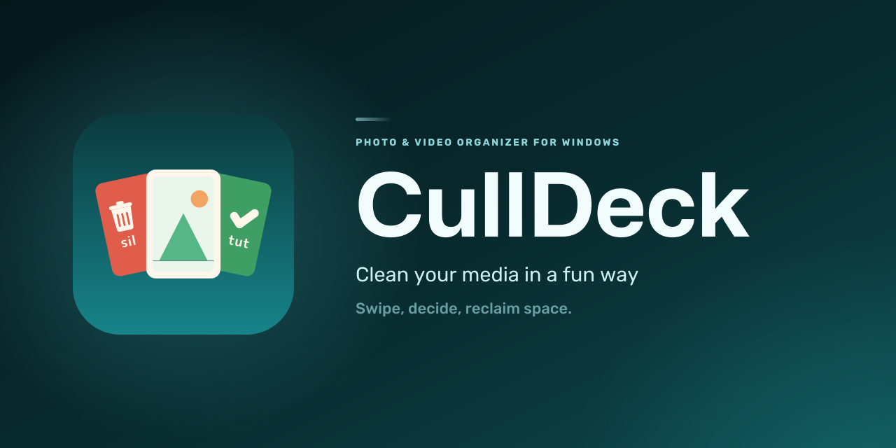
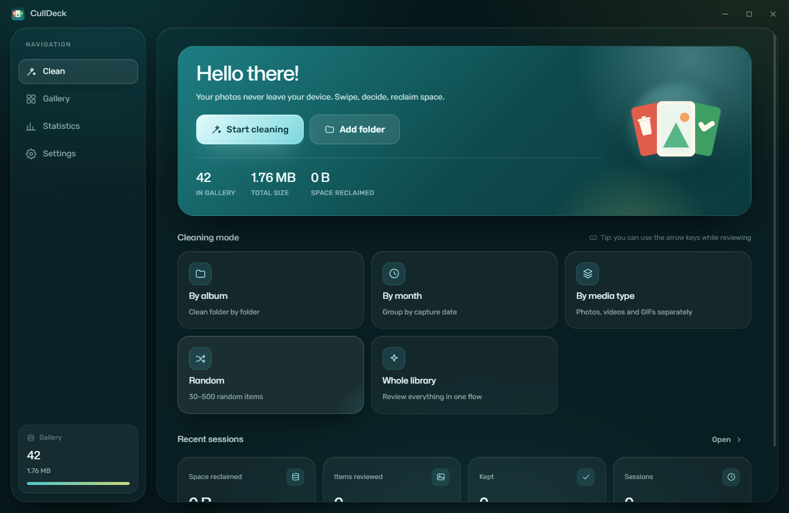
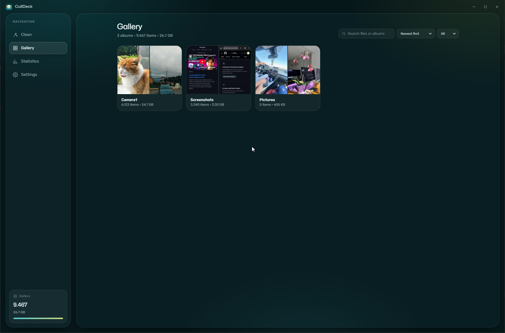
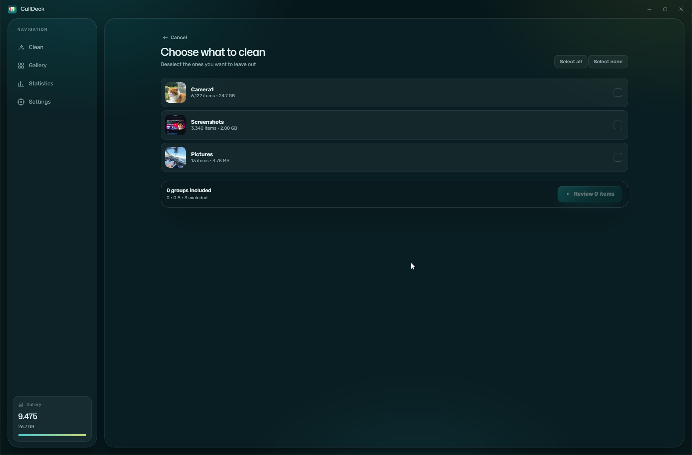
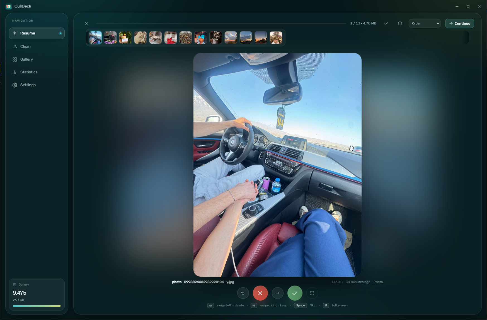
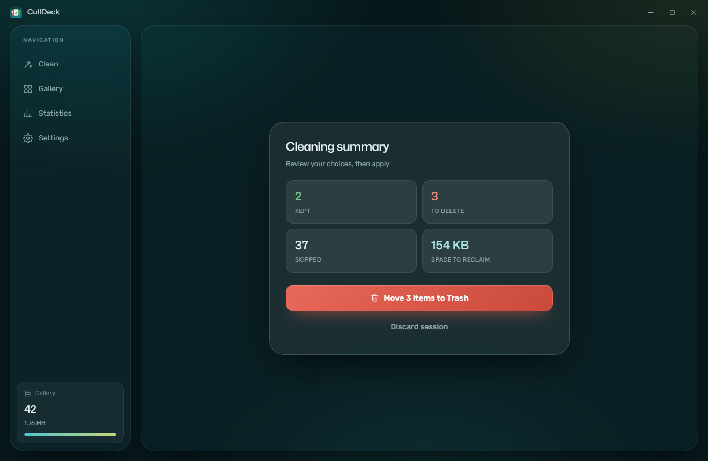
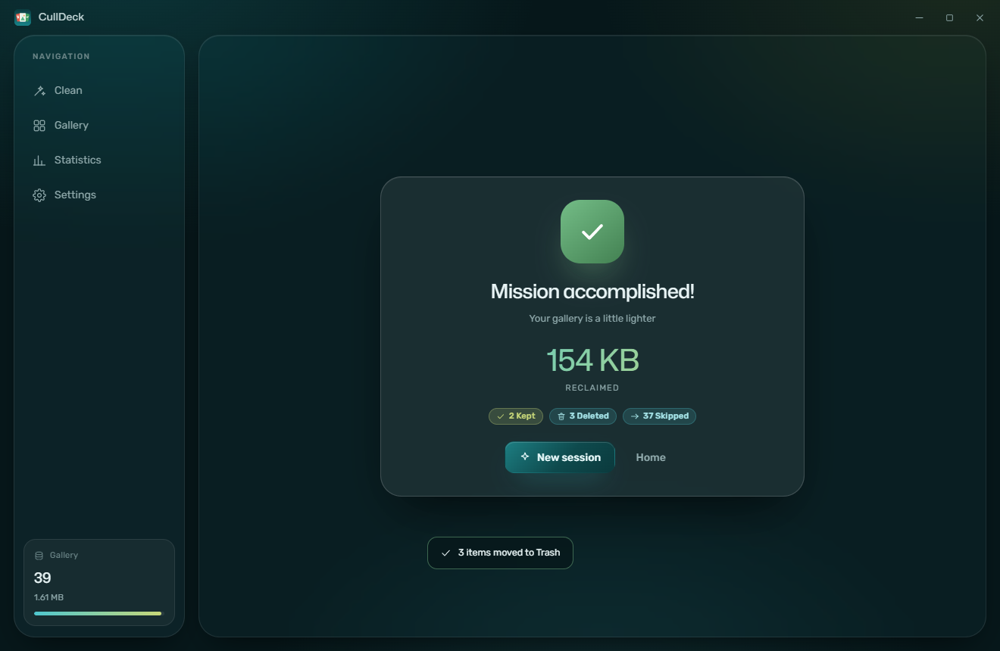
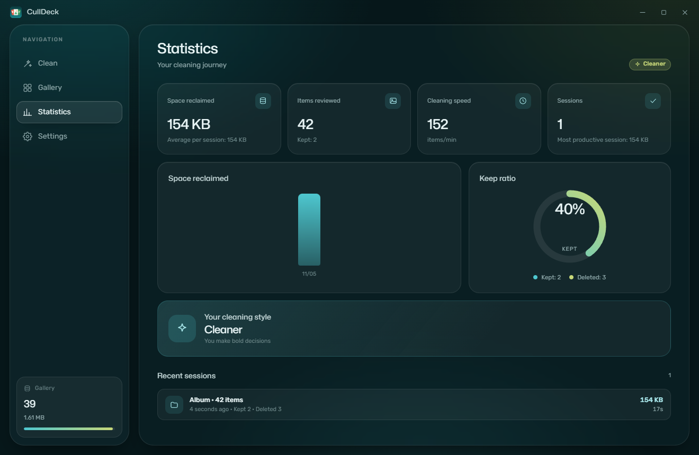
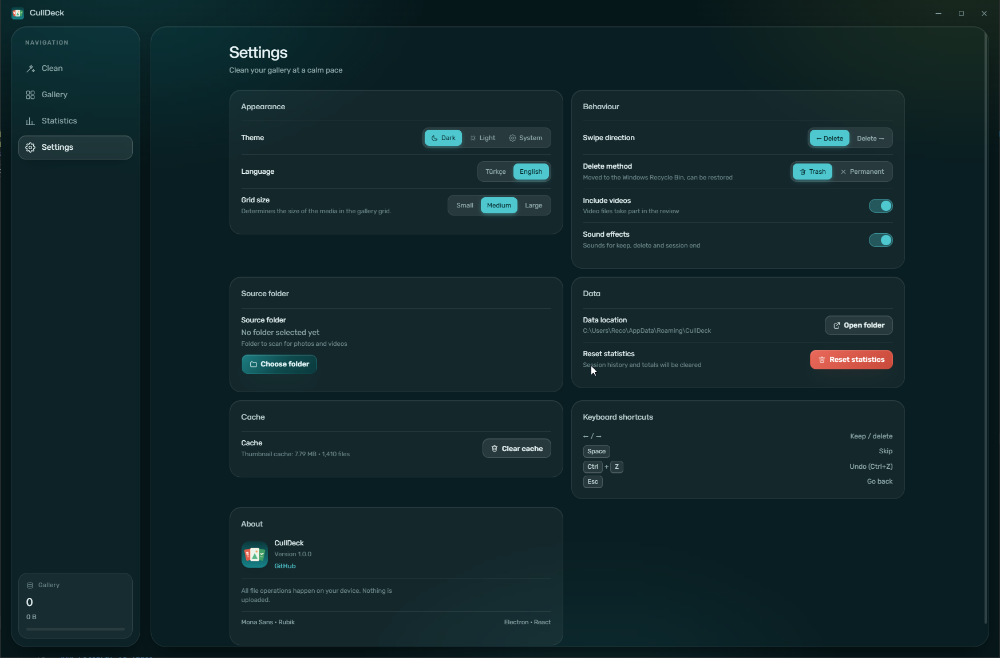

<p align="center">
  
</p>

<h1 align="center">CullDeck</h1>

<p align="center">
  <b>A local photo and video cleaning app for Windows.</b><br>
  Swipe through your library and reclaim space — your files never leave your device.
</p>

<p align="center">
  
  
  
</p>

<p align="center">
  <b>English</b> · <a href="README.md">Türkçe</a>
</p>

---

## What is CullDeck?

CullDeck is a desktop app built to help you quickly review thousands of photos and videos and get rid of the ones you no longer need. It scans your folders, groups media by album, month or type, and lets you decide item by item. Everything happens **on your computer** — no file is ever uploaded.

## Screenshots

| Home | Gallery |
| :---: | :---: |
|  |  |

| Selection | Review |
| :---: | :---: |
|  |  |

| Summary | Completed |
| :---: | :---: |
|  |  |

| Statistics | Settings |
| :---: | :---: |
|  |  |

## Features

### Fast review
- Drag the card with your mouse or use the arrow keys: **keep**, **delete** or **skip**.
- Undo a wrong decision with **Ctrl+Z**.
- Progress bar, remaining size and space to be reclaimed update instantly.
- Sessions you leave unfinished are saved automatically; resume where you stopped.
- Bulk select to mark many items at once.

### Cleaning modes
- **By album** — clean folder by folder.
- **By month** — group by capture date (EXIF).
- **By media type** — review photos, videos and GIFs separately.
- **Random** — pick 30–500 random items.
- **Whole library** — review everything in one flow.

### Gallery
- Album cards, search, type filter and sorting (date, size, name).
- Small, medium and large grid sizes.
- Zoom: mouse wheel to zoom, double-click for 100%, drag to pan.
- Send selected items straight to review or move them to Trash in bulk.
- Reveal a file in its folder or open it in the default app.

### Photos and videos
- EXIF details for photos: camera, lens, ISO, aperture, exposure, focal length.
- Playback speed, 5-second seek, full screen and mute support.
- External player shortcut for unsupported containers (AVI, WMV, FLV, MPG, etc.). **No video transcoding** — files stay exactly as they are.
- Broken or unreadable files can still be deleted.

### Safe deletion
- Choose between **Trash** (default) and **permanent delete**.
- Permanent delete asks for confirmation and cannot be undone.
- Apply deletions from the summary card with one click; results are reported immediately.

### Statistics
- Space reclaimed, items reviewed/deleted/kept, and session history.
- Cleaning speed (items/min), keep ratio and a space-reclaimed chart.
- "Your cleaning style" feedback.

### Personalization
- Dark, light or system theme.
- Turkish and English interface.
- Swipe direction, deletion method, video scanning and sound effects toggles.
- Clear thumbnail cache and open the data folder.

## How it works

1. **Add a folder** — CullDeck scans it and extracts albums and capture dates.
2. **Pick a scope** — choose a mode and select albums, months or media types.
3. **Review** — keep, delete or skip. Confirm the summary at the end.

## Installation

1. Download `CullDeck-Setup-1.0.0.exe` (installer) or `CullDeck-Portable-1.0.0.exe` (no install) from the [Releases](https://github.com/yreco28/CullDeck/releases) page.
2. Run the Setup file to install; the default target folder is `C:\Users\.....\AppData\Local\Programs\CullDeck` and you can change it if you like. If you prefer no installation, launch the Portable file directly.
3. Launch CullDeck and choose a photo folder.

> **System requirement:** Windows 10 or 11 (64-bit).

## Keyboard shortcuts

| Key | Action |
| --- | --- |
| `←` / `→` | Keep / delete (depends on the swipe direction setting) |
| `Space` | Skip |
| `Ctrl+Z` | Undo |
| `F` | Full screen |
| `Esc` | Exit full screen / go back |
| `Ctrl+Enter` | Pause the review and save the session |
| Wheel · double-click · drag | Zoom · 100% · pan (while zoomed) |

## Privacy

- Your files are **never uploaded**; scanning, thumbnail generation and deletion all happen on your device.
- No account, cloud, ads or analytics.
- The app denies camera, microphone, location and clipboard permissions.
- It works without an internet connection.

## Building from source

Requirements: [Node.js](https://nodejs.org/) 20.19+ (or 22.12+) and npm.

```bash
git clone https://github.com/yreco28/CullDeck.git
cd CullDeck
npm install
npm run dev
```

## FAQ

**Are my photos uploaded anywhere?**  
No. CullDeck is fully local and works offline.

**Can I recover deleted files?**  
In the default **Trash** mode, yes — restore them from the Windows Recycle Bin. **Permanent delete** cannot be undone.

**Are my videos converted?**  
No. CullDeck never transcodes videos; it only plays and deletes them.

**Which file types are supported?**  
JPEG, PNG, WebP, GIF, HEIC/TIFF (preview may be limited) and video containers Chromium can play, such as MP4, WebM and MOV.

## License

This project is licensed under the [MIT License](LICENSE).

<p align="center">
  <a href="https://github.com/yreco28/CullDeck">github.com/yreco28/CullDeck</a>
</p>
