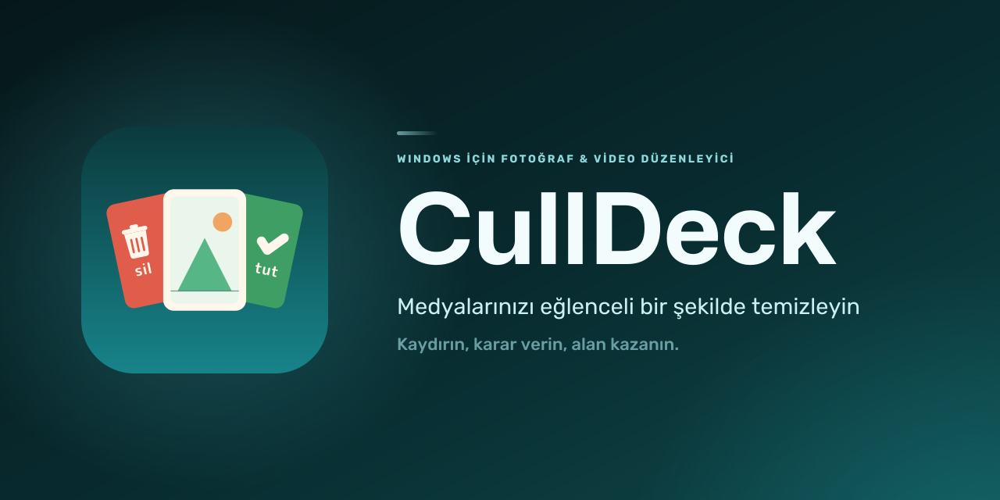
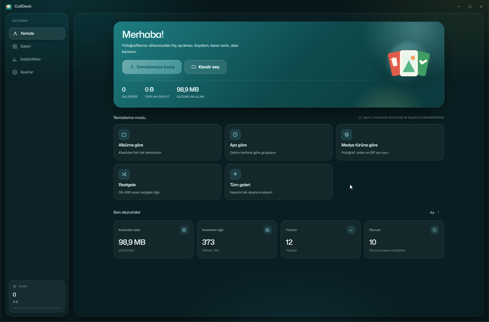
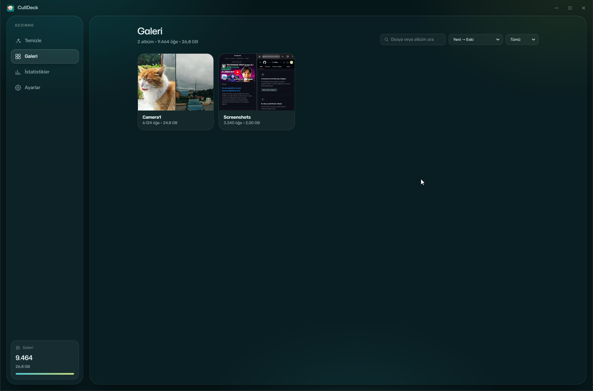
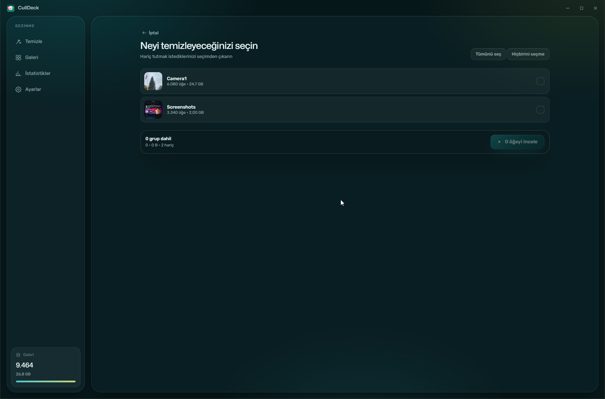
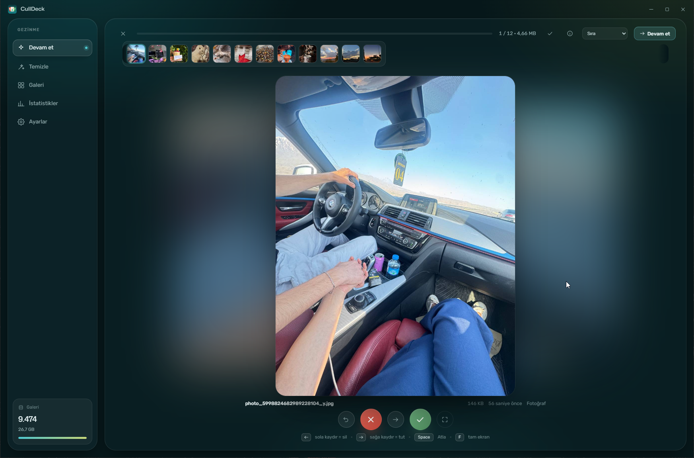
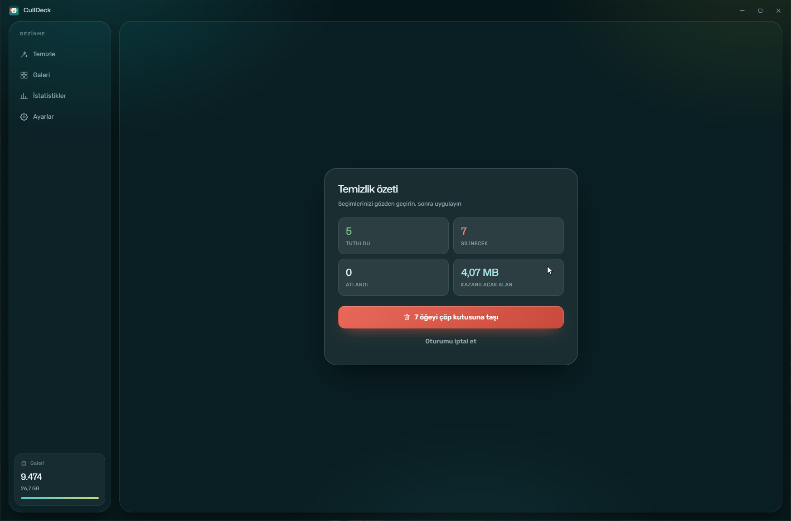
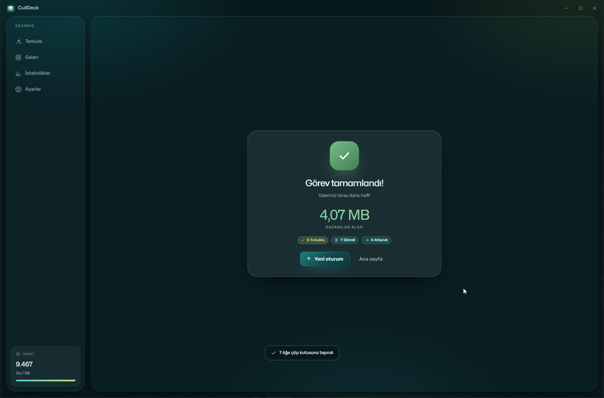
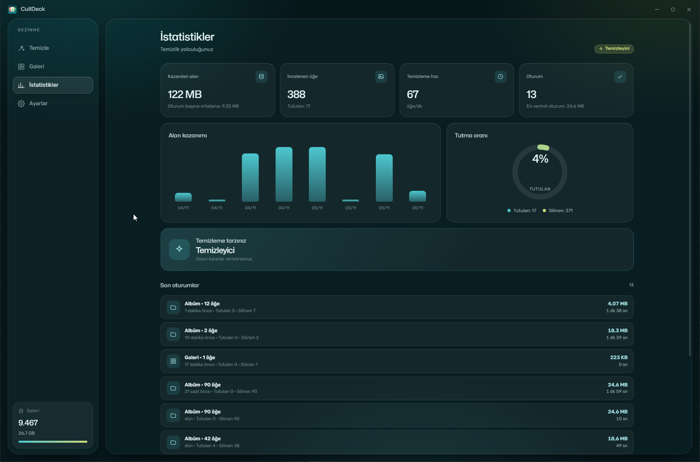
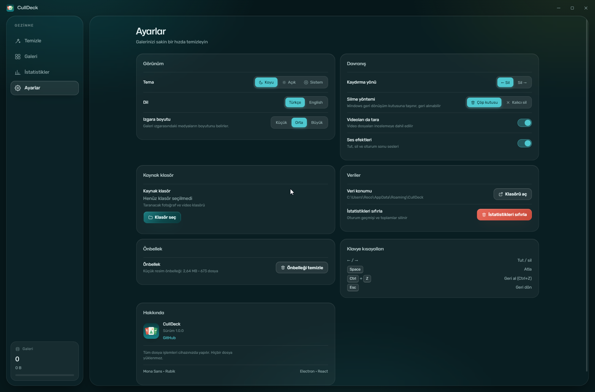

<p align="center">
  
</p>

<h1 align="center">CullDeck</h1>

<p align="center">
  <b>Windows için yerel fotoğraf ve video temizleme uygulaması.</b><br>
  Galerinizi kaydırarak temizleyin; dosyalarınız cihazınızdan hiç ayrılmasın.
</p>

<p align="center">
  
  
  
</p>

<p align="center">
  <a href="README.en.md">English</a> · <b>Türkçe</b>
</p>

---

## CullDeck nedir?

CullDeck, binlerce fotoğraf ve videoyu hızlıca gözden geçirip gereksiz olanlardan kurtulmanız için tasarlanmış bir masaüstü uygulamasıdır. Klasörlerinizi tarar, medyayı albüm, ay veya tür bazında gruplar ve tek tek karar vermenizi sağlar. Tüm işlemler **bilgisayarınızda** yapılır; hiçbir dosya internete yüklenmez.

## Ekran görüntüleri

| Ana sayfa | Galeri |
| :---: | :---: |
|  |  |

| Seçim | İnceleme |
| :---: | :---: |
|  |  |

| Özet | Tamamlandı |
| :---: | :---: |
|  |  |

| İstatistikler | Ayarlar |
| :---: | :---: |
|  |  |

## Özellikler

### Hızlı inceleme
- Kartı fareyle sürükleyin veya ok tuşlarını kullanın: **tut**, **sil** ya da **atla**.
- Yanlış kararı **Ctrl+Z** ile geri alın.
- İlerleme çubuğu, kalan süre ve kazanılacak alan anlık güncellenir.
- Yarıda bıraktığınız oturumlar otomatik kaydedilir; kaldığınız yerden devam edersiniz.
- Toplu seçim ile birden fazla öğeyi tek seferde işaretleyin.

### Temizleme modları
- **Albüme göre** — klasörleri tek tek temizleyin.
- **Aya göre** — çekim tarihine (EXIF) göre gruplayın.
- **Medya türüne göre** — fotoğraf, video ve GIF'leri ayrı ayrı inceleyin.
- **Rastgele** — 30–500 arasında rastgele öğe seçin.
- **Tüm galeri** — her şeyi tek akışta gözden geçirin.

### Galeri
- Albüm kartları, arama, türe göre filtreleme ve sıralama (tarih, boyut, ad).
- Küçük, orta ve büyük ızgara boyutu.
- Yakınlaştırma: tekerlekle zoom, çift tıkla %100, sürükleyerek gezinme.
- Seçilenleri doğrudan incelemeye gönderin veya toplu olarak çöp kutusuna taşıyın.
- Dosyayı klasörde gösterin veya varsayılan uygulamada açın.

### Fotoğraf ve video
- Fotoğraflarda EXIF bilgileri: kamera, lens, ISO, diyafram, pozlama, odak.
- Oynatma hızı, 5 saniye ileri/geri, tam ekran ve sessize alma desteği.
- Desteklenmeyen kaplar (AVI, WMV, FLV, MPG gibi) için harici oynatıcı kısayolu. **Video dönüştürme (transcode) yapılmaz**; dosyalar olduğu gibi kalır.
- Bozuk veya önizlemesi açılmayan dosyalar da silinebilir.

### Güvenli silme
- **Çöp kutusu** (varsayılan) veya **kalıcı sil** arasından seçim yapın.
- Kalıcı silmede onay istenir; işlem geri alınamaz.
- Silme işlemi özet kartından tek tıkla uygulanır; sonuçlar anında raporlanır.

### İstatistikler
- Kazanılan alan, incelenen/silinen/tutulan öğe sayısı ve oturum geçmişi.
- Temizleme hızı (öğe/dk), tutma oranı ve alan kazanımı grafiği.
- "Temizleme tarzınız" geri bildirimi.

### Kişiselleştirme
- Koyu, açık veya sistem teması.
- Türkçe ve İngilizce arayüz.
- Kaydırma yönü, silme yöntemi, video tarama ve ses efektleri açma/kapatma.
- Küçük resim önbelleğini temizleme ve veri klasörünü açma.

## Nasıl çalışır?

1. **Klasör ekleyin** — CullDeck klasörü tarar, albümleri ve çekim tarihlerini çıkarır.
2. **Kapsamı seçin** — bir mod ve albüm/ay/tür seçin.
3. **İnceleyin** — tutun, silin veya atlayın. Sonunda özeti onaylayın.

## Kurulum

1. [Releases](https://github.com/yreco28/CullDeck/releases) sayfasından `CullDeck-Setup-1.0.0.exe` (kurulum) veya `CullDeck-Portable-1.0.0.exe` (kurulumsuz) dosyasını indirin.
2. Kurulum için Setup dosyasını çalıştırın. Varsayılan hedef klasör `C:\Users\.....\AppData\Local\Programs\CullDeck` olur; isterseniz değiştirebilirsiniz. Kurulum istemiyorsanız Portable dosyasını doğrudan başlatın.
3. Kurulumdan sonra CullDeck'i başlatın ve bir fotoğraf klasörü seçin.

> **Sistem gereksinimi:** Windows 10 veya 11 (64-bit).

## Klavye kısayolları

| Tuş | İşlev |
| --- | --- |
| `←` / `→` | Tut / sil (kaydırma yönü ayarına göre) |
| `Space` | Atla |
| `Ctrl+Z` | Geri al |
| `F` | Tam ekran |
| `Esc` | Tam ekrandan çık / geri dön |
| `Ctrl+Enter` | İncelemeyi duraklat ve oturumu kaydet |
| Tekerlek · çift tık · sürükle | Yakınlaştır · %100 · gezin (yakınlaştırmada) |

## Gizlilik

- Dosyalarınız **hiçbir sunucuya yüklenmez**; tüm tarama, küçük resim üretimi ve silme işlemleri cihazınızda yapılır.
- Hesap, bulut, reklam veya analitik yoktur.
- Uygulama kamera, mikrofon, konum ve pano izinlerini reddeder.
- İnternet bağlantısı olmadan çalışır.

## Kaynaktan derleme

Gereksinimler: [Node.js](https://nodejs.org/) 20.19+ (veya 22.12+) ve npm.

```bash
git clone https://github.com/yreco28/CullDeck.git
cd CullDeck
npm install
npm run dev
```

## SSS

**Fotoğraflarım bir yere yükleniyor mu?**  
Hayır. CullDeck tamamen yereldir ve çevrimdışı çalışır.

**Sildiğim dosyaları geri alabilir miyim?**  
Varsayılan **Çöp kutusu** modunda evet, Windows Geri Dönüşüm Kutusu'ndan geri yükleyebilirsiniz. **Kalıcı sil** modunda geri alma yoktur.

**Videolarım dönüştürülüyor mu?**  
Hayır. CullDeck videoları transcode etmez; yalnızca oynatır ve siler.

**Hangi dosya türleri destekleniyor?**  
JPEG, PNG, WebP, GIF, HEIC/TIFF (önizleme kısıtlı olabilir) ve MP4, WebM, MOV gibi Chromium'un oynatabildiği video kapları.

## Lisans

Bu proje [MIT Lisansı](LICENSE) ile lisanslanmıştır.

<p align="center">
  <a href="https://github.com/yreco28/CullDeck">github.com/yreco28/CullDeck</a>
</p>
